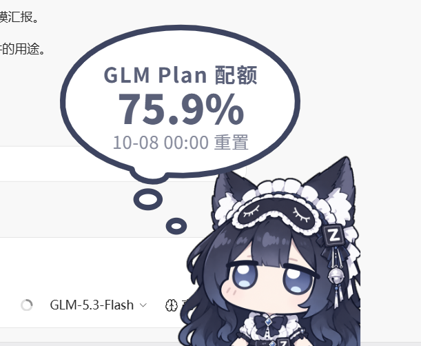

# WorkBuddy狐娘小挂件（fox-widget）

<div align="center"></div>

> 产品名 **WorkBuddy狐娘小挂件**（英文名 Fox Widget）。在 WorkBuddy 里常驻一位嘎啦嘛（可一键切回原版大肥鱼，或上传任意形象）：
>
> - **今日积分**（主口径）——WorkBuddy 是订阅积分制，模型由宿主托管，每轮对话消耗多少 credit 由宿主算好
> - **当前会话上下文余量**（`已用 x / 总量`，如「上下文 22%」）
> - **上一轮消耗**——每轮对话结束弹一个气泡告诉你这一轮花了多少积分、多少次模型调用、以及一个按公开价目折算的**等价金额参考值**
> - 可选：**DeepSeek 余额**与 35 家厂商模板（需自己配 key；WorkBuddy 默认不需要）
>
> 它浮在 WorkBuddy 窗口的右下角，跟着窗口移动/最小化/关闭，指针不在它身上时点击直接穿透到下面的应用——**不挡任何操作**；开「桌宠模式」后以整个屏幕工作区为家，切应用也不隐身，一直浮在最上层。

> **本仓库是 `workbuddy` 分支**，与 `main` 分支（ZCode 版）同源双分支。共享内核（页面、本地服务、定价、厂商模板、记账、浮层、测试框架）约占全仓七成；宿主差异集中在 `lib/host.mjs` 一个文件里。
> 分支策略、发版口径与同步纪律见 [`CONTRIBUTING.md`](./CONTRIBUTING.md)；维护手册与决策记录见 [`docs/MAINTAINING.md`](./docs/MAINTAINING.md)、[`docs/DECISIONS.md`](./docs/DECISIONS.md)。

---

## 移植关系与协议

**本项目不是原创，是「移植的移植」。** 视觉与交互设计、鲸鱼素材、音效、台词、峰谷定价表和计费口径来自上游项目：

| | |
|---|---|
| **原版** | [MeteorNOX/DeepSeek-Balance-Whale-Widget](https://github.com/MeteorNOX/DeepSeek-Balance-Whale-Widget)（MIT，Copyright (c) 2026 MeteorNOX）——DSH（DeepSeek Harness）的 Web 插件 |
| **ZCode 移植** | [nb10yyds/zcode-whale-widget](https://github.com/nb10yyds/zcode-whale-widget) → 本仓库 `main` 分支的 `zcode-fox-widget`（ZCode狐娘小挂件） |
| **本分支** | 自 `zcode-fox-widget` v1.11.1 移植到 WorkBuddy，版本号另起序列（tag 前缀 `wb-v`） |

**沿用自上游**：`assets/` 下上游素材（鲸鱼形象、`rua.gif`、两套音效）、气泡 SVG 几何、字号档、动画参数、拖拽/四分吸附/左吸附镜像/alpha 命中检测、随机台词六组的文案与权重、峰谷定价表与时段规则、记账模式语义、余额接口取项规则。

**新增素材（非上游）**：`GLM.png`（嘎啦嘛）、`gpt.png`（GPT娘）、`kimi.png`（kimi娘）、`gemini.png`（哈基米）、README 头图 `wb.png`（WorkBuddy 版形象） —— 均为项目自有素材；`xiaoke.png`（小克）取自 [aklnaaw/dsh-xiaoke-widget](https://github.com/aklnaaw/dsh-xiaoke-widget)（MIT），**已获原作者授权**。六张内置立绘统一到同一画布规格：**610×610 画布、内容高 587、内容右边与底边都贴到画布边**（右下对齐是刚需——挂件贴屏幕右缘，右对齐才能做到切换角色时角色不横向跳），视觉上六个角色的身高与离右边框的距离一致。

**ZCode 版移植期重写**：本地服务 + 独立页面 + 桌面浮层；三级凭据发现链；MCP / 钩子 / CLI。
**本分支再重写数据源**：清单与钩子换宿主格式，积分与上下文改读 `workbuddy.db` + transcript，
主题与凭据改读宿主配置，浮层跟随 `WorkBuddy`，宿主差异收敛到 `lib/host.mjs`。

逐条清单见 [`NOTICE`](./NOTICE)；MIT 许可全文见 [`LICENSE`](./LICENSE)。fork 之后新增了什么，见下一节与 [CHANGELOG](./CHANGELOG.md)。

---

## 功能总览（基础功能）

- **今日积分（主口径）**：读宿主 `workbuddy.db` 与会话 transcript 里每次模型调用带的 `credit`
  （宿主算好的积分），按日聚合；另有**上下文余量**（宿主的 `used / size`，显示「上下文 xx%」）。
- **每轮对话消耗**：一轮对话结束弹一个红色气泡，显示这一轮消耗多少**积分**（多少次模型调用）、
  外加一个按公开价目折算的**等价金额参考值**（界面标 `≈`），可逐档核对 token 分桶明细。
- **可选：余额与额度**：DeepSeek 走内置余额接口（需自己配 key）；**CommandCode 三重额度**保留在厂商卡层；
  另有 **35 个厂商模板**（含 Kimi Coding / MiniMax Coding / OpenCode Go 等订阅窗口与 **Gemini 订阅（AI Pro/Ultra）**，以及 OpenAI / Anthropic /
  Gemini / 硅基流动 / 火山方舟 等「官方没有 API key 查余额」的厂商——这类只报凭据状态）。
  **WorkBuddy 默认没有用户自带凭据，所以这些卡默认全部「未配置」——这是预期，不是故障**。
  **GLM Plan 配额在本分支已砍**（唯一数据源是 ZCode 客户端日志，宿主无对应物）。
- **记账二级页**：一级菜单有「**用量记录…**」（今日 / 近 7 天 / 逐轮明细，积分口径）与「**=角色名记账=**」入口；额度预警、余额预警、余额校正收进记账页。
- **预警**：一条「额度%」阈值对 GLM Plan 与 CommandCode 同时生效，加一条「余额¥」管 DeepSeek 余额见底；每源每天最多提醒一次，恢复后自动重新武装。
- **桌宠模式**（浮层专属）：开启后挂件以**整个屏幕（工作区，自动排除任务栏）**为界面，可拖出 WorkBuddy 窗口放到屏幕任何角落，且锁在所有窗口最上层——切到别的应用、WorkBuddy 被盖住或最小化也不隐身；关闭后回到「跟随 WorkBuddy 窗口」的原有行为。
- **挂件交互**：拖拽、四边四分之一吸附、左吸附水平镜像（文字保持可读）、按压 Q 弹 + 音效、余额变化数字滚动、点击角色弹气泡、再点**气泡**切换下一句（点角色只延长气泡显示、气泡会轻弹一下作为反馈）（含 rua 动图；台词按内置角色分套——大肥鱼 = 原版文案也是默认套，嘎啦嘛 / GPT娘 / kimi娘 / 小克 各有一套专属台词，用户导入的角色用鲸鱼套；切角色当场换台词，不用刷新页面）。
- **汉堡菜单**：大小 0.6–2.5×、音效、音量、角色、对账口径、峰谷播报、主题（跟随 WorkBuddy / 浅色 / 深色）、显示、气泡开关、按压泡泡、每轮消耗提示与自动关闭秒数、避让滚动条，浮层下还有「桌宠模式」与「跟随延迟」。
- **会话自启**：打开 WorkBuddy（新会话）时自动拉起，不用手动开。
- **随窗口联动**：WorkBuddy 移动/缩放时跟着走，最小化或被别的应用盖住时隐藏（除非开了桌宠模式），WorkBuddy 退出时一起退出。

---

## 与上游的差异

WorkBuddy 线以 **订阅积分** 为主口径，与 ZCode 线（按量余额）不是同一套叙事：

| 维度 | 上游 / ZCode 线 | 本分支 |
|---|---|---|
| 主显示 | DeepSeek 余额 + 今日已用 | 今日积分 / 本轮 credit / 上下文余量 |
| 数据源 | 按量余额接口 + 本机库 | 宿主 `workbuddy.db` + 会话 transcript |
| 窗口 | 宿主内嵌页面 | 自建透明置顶浮层（Electron） |
| GLM Plan 配额 | 有 | 已砍（宿主无对应数据源） |
| 厂商卡 | 核心功能 | 可选附加（宿主默认无自带 key） |
| 发布 | `main` 分支 · `v*` tag | `workbuddy` 分支 · `wb-v*` tag |

逐版本细节见 [CHANGELOG](./CHANGELOG.md)；移植前的历史见 [归档](./docs/CHANGELOG-ARCHIVE.md)。

## 显示方式：桌面浮层（推荐）

一个独立的 Electron 窗口：透明、无边框、不进任务栏、始终置顶，覆盖 WorkBuddy 窗口但默认鼠标
穿透（只接管落在鲸鱼/气泡/菜单上的指针）。装好运行时后随会话自启。



浏览器打开 `http://127.0.0.1:<port>/` 是**同一个页面**（排障与非 Windows 的备用入口）；端口以
`node lib/cli.mjs start` 输出或 `server.json` 的 `url` 为准，只监听 `127.0.0.1`。

## 安装

前置：WorkBuddy 客户端（插件系统）、`node -v` 可用（自带 v22.22.2）、Windows（浮层依赖 Win32；
macOS / Linux 只能用本地页面）。

1. **选安装来源（二选一）**

   **A. 直接填 GitHub 源（推荐）**：左栏「专家·技能·连接器」→「技能」→ 子分页「插件」→ 右上角
   `＋` → 「市场源」填 workbuddy 分支的 ZIP 地址：

   ```text
   https://github.com/pigeon189/zcode-fox-widget/archive/refs/heads/workbuddy.zip
   ```

   它**不认 `owner/repo#分支`**：填 `pigeon189/zcode-fox-widget` 会拉默认分支 `main`（ZCode 线，
   没有 `.codebuddy-plugin/`），市场里不会出现 `fox-widget`。升级 = 在市场里点「刷新」。

   **B. 克隆到本地目录**（要改代码时用）：

   ```bash
   git clone -b workbuddy https://github.com/pigeon189/zcode-fox-widget.git ~/.workbuddy/dev/fox-widget
   ```

   然后在同一入口点 `＋`，在「市场源」里粘贴**仓库绝对路径**（该对话框只有一个文本框，不是
   文件夹选择框）。宿主的 `parseSource()` 会「路径存在 → 当作本地目录市场」，所以填市场名 /
   插件名 / 相对目录名都不生效；路径要指向含 `.codebuddy-plugin/marketplace.json` 的仓库根。
   别走「导入技能」——那条路只收 `.skill` 包。

   > 同时装 ZCode 版时，给本分支**单独克隆一份**：两个宿主盯同一个工作区，任一端「重新抓取」
   > 都会覆盖另一端的认知。

2. **安装并启用**：在市场 `fox-local` 下安装 `fox-widget`，安装范围选 **user**。清单已写
   `defaultEnabled: true`，正常装完即启用（手工启用见 `docs/MAINTAINING.md` §0）。
3. **重启会话**（或重开 WorkBuddy）让 MCP 与钩子生效；要用桌面浮层再装运行时（约 150MB 下载 / 370MB 占用，一次性，装在插件数据目录）：

   ```bash
   node lib/cli.mjs desktop install
   ```

装好后打开 WorkBuddy，鲸鱼会自己出现。

### 更新

本分支**默认关闭挂件内自更新**：ZCode 式「原地覆盖所有安装目录」会和宿主插件管理打架（宿主用
目录名 + `installed_plugins.json` 记版本）。推荐 `git pull` + 市场页「刷新」+ 重启客户端；数据
都在插件数据目录，配置不丢。想开自更新就设 `FOX_WIDGET_ENABLE_UPDATE_CHECK=1`（行为与 ZCode
线一致：6 小时自检、镜像候选链、先备份再替换），并接受上述混用风险。

发版口径：tag 用 `wb-v*`，探测读 `workbuddy` 分支，GitHub API 从 releases 里挑 `wb-v*` 的最高
版本（不能用 `releases/latest`——两线共用仓库）。出站白名单与签名校验见
[`docs/DECISIONS.md#update-probe`](./docs/DECISIONS.md#update-probe)。

---

## 首次配置

### API Key（可选功能，一般不用配）

> **主口径（积分）完全不需要配 Key。** 下面只服务「可选的厂商余额卡」：默认找不到任何用户
> 自带的凭据，这是预期行为，不是故障。

查找顺序：环境变量 `DEEPSEEK_API_KEY` → 插件数据目录 `config.json` 的 `apiKey` /
`vendorKeys.<模板 id>` → 宿主 `settings.json` 的 `env` 与 `pluginConfigs`（实测通常为空）。
写入方式（任选其一）：

```bash
echo 'sk-xxxxxxxxxxxxxxxx' | node lib/cli.mjs key   # 从 stdin 读（密钥不进 shell 历史与进程列表）
```

或让会话里的模型直接调 MCP 工具 `whale_config`（`action=set`, `apiKey=...`）。

密钥只在内存中使用，只发往 `api.deepseek.com` / `platform.deepseek.com`，不写日志、只显示掩码。

### 关掉不想要的自动化

`${CODEBUDDY_PLUGIN_DATA}/config.json`：

| 字段 | 默认 | 作用 |
|---|---|---|
| `autoStartWidget` | `true` | 会话启动时自动拉起挂件服务（看门狗也照它怠速） |
| `autoStartOverlay` | `true` | 会话启动时顺便拉起桌面浮层 |
| `followIntervalMs` | `40` | 跟随探测间隔（毫秒），菜单里的选择会覆盖它 |
| `port` | 自动（39321） | 固定端口，被占用时自动顺延 |

改完重启会话生效。

---

## 使用指南

### 打开 WorkBuddy 就自动出现

插件自带 SessionStart hook，**每次会话启动都会幂等拉起**（已在跑就复用，不会重复开）。确认方法：

```bash
cat ${CODEBUDDY_PLUGIN_DATA}/autostart.log      # 每次启动追加一行，如 server=started overlay=reused
```

> SessionStart 是在**会话启动**时触发的。正常情况下打开 WorkBuddy 会恢复/创建会话，所以碰不到边界情况。

#### 冷启动死角与看门狗（推荐补装）

实测 WorkBuddy **应用启动本身不触发任何插件钩子**（钩子与插件 MCP 都随「会话动作」——回退对话 / 新对话 / 发消息——而来），而钩子拉起的服务与浮层长在宿主进程树上，应用退出即被收走。于是存在一个死角：**启动 WorkBuddy 后一动不动 = 桌面上没有挂件**。

看门狗（`lib/watchdog.mjs`）补这个缺口：一个登录自启的独立小进程，监听宿主 `logs/AppStartup.log` / `AppShutdown.log`，WorkBuddy 一启动就把「服务 + 浮层」拉起来，运行期每 15s 自检补活（服务被会话切换连带杀掉也会被拉回），宿主退出后宽限 5 分钟再停服务。

装一次即可（**每台机器一次，不是每次开机**）：

```bash
node lib/cli.mjs desktop install     # 装 Electron 运行时的同时**顺手装好看门狗**（推荐路径）
node lib/cli.mjs watchdog install    # 也可以单独装（只装看门狗，跳过运行时）
node lib/cli.mjs watchdog status     # 查看自启项与进程状态
node lib/cli.mjs watchdog uninstall  # 移除
```

启动项写在启动文件夹（`fox-widget-watchdog.vbs`，用户级、免管理员、删文件即卸载），登录时它会自动挑最新的插件副本与可用的 node，所以**插件升级后不需要重装**。日志在 `${CODEBUDDY_PLUGIN_DATA}/watchdog.log`。`autoStartWidget=false` 时看门狗怠速（不拉起任何东西）；排障可临时 `FOX_WIDGET_NO_WATCHDOG=1`。菜单里的「关闭插件」会让看门狗**在本次**停手（它每 15 秒补活，不拦就白关了；见「使用指南」的「挂件菜单」末行）。

### 命令行

```bash
node lib/cli.mjs status          # 今日积分 + 上下文余量 + 近 7 天 + 挂件服务与桌面浮层状态
node lib/cli.mjs turn            # 上一轮对话消耗（积分 + 等价金额 + 逐档明细）
node lib/cli.mjs start / stop    # 启停挂件服务（浮层与本地页面共用同一个）
node lib/cli.mjs close           # 关闭插件：停浮层与服务（本次关闭，看门狗本次也停手；下次启动照常拉起）
node lib/cli.mjs window start    # 启动桌面浮层（浮在 WorkBuddy 界面上）
node lib/cli.mjs window stop     # 关闭浮层
node lib/cli.mjs window status   # 浮层与运行时状态
node lib/cli.mjs desktop install # 安装 Electron 运行时（仅浮层需要，一次性）
node lib/cli.mjs watchdog install # 装看门狗：WorkBuddy 一启动挂件就位（见上节）
echo 'sk-...' | node lib/cli.mjs key   # 写入 API Key（走 stdin，不留命令行痕迹）
node lib/cli.mjs mode ledger|token  # 切换对账口径（大肥鱼记账 / 实时·令牌）
node lib/cli.mjs json            # 结构化输出，便于脚本消费
```

### 在对话里直接用

- 输入 `/fox`（或 `/fox turn`、`/fox window start`；写 Key 建议用上面的 stdin 方式，避免密钥留在对话与命令行历史里）
- 或者直接问「我还有多少余额」「上一轮花了多少」，WorkBuddy 会调用 MCP 工具：

| MCP 工具 | 作用 |
|---|---|
| `whale_balance` | 余额、今日已用、当前峰谷时段 |
| `whale_last_turn` | 上一轮消耗金额与逐档明细 |
| `whale_widget` | `start` / `stop` / `status` / `url` / `close`（关闭插件），以及浮层的 `overlay_start` / `overlay_stop` / `overlay_status` |
| `whale_config` | 查看或修改配置（API Key、对账口径、端口、自启、跟随间隔） |

### 挂件菜单

悬停鲸鱼 → 右上角出现三点按钮 → 点击打开菜单：

| 项 | 说明 |
|---|---|
| 大小 | 0.6–2.5×，滑块或数字（1–20）；只缩放角色本体与气泡，菜单/面板尺寸恒定 |
| 音效 / 音量 | 内置小黄鸭/音效1，可导入自定义音效（1 个=按压松手共用，2 个=按压+松手）；音量 0 即静音 |
| 角色 | 选形象（内置：嘎啦嘛 / 大肥鱼 / GPT娘 / kimi娘 / 小克 / 哈基米）；导入的图可改名/删除，内置形象也能隐藏（`roles.json` 的 `hiddenBuiltins`，清掉即找回）。手选后自动关掉「按模型换角色」 |
| 按模型换角色 | 默认开：按模型厂商族自动换形象（GLM→嘎啦嘛、DeepSeek→大肥鱼、GPT→GPT娘、Kimi→kimi娘、Claude→小克、Gemini→哈基米），配色与台词池一起换；认不出的保持不动 |
| 气泡 | 左侧开关控制思考气泡显隐；「按压泡泡设置」打开自定义队列（可视化编辑器）；行末「等确认提醒」默认关（宿子弹通知时提醒一次，同一件事只提醒一次） |
| 对账口径 | 大肥鱼记账 / 实时·令牌（v1.7.0 起决定「对账 + 兜底」用哪个账号数字，主显示固定本机库） |
| 峰谷播报 | 台词里峰谷文案的风格（默认 / 梁文峰谷 / !?强强?!） |
| 主题 | 浅色模式 / 深色模式 / 跟随 WorkBuddy（三层判定：浮层观测 WorkBuddy 窗口的 DWM 暗色标志 > 配置 ui.theme > 操作系统深浅色） |
| 显示 | 气泡主显示跟随哪个计费源（自动 / Plan / CommandCode / GLM / DeepSeek） |
| 每轮消耗提示 | 是否在每轮结束后弹消耗气泡；自动关闭秒数（0 = 手动关）。提示内容在「按压泡泡设置」首分区编辑 |
| 避让滚动条 | 让挂件右侧避开滚动条的像素宽度（默认关） |
| 隐藏菜单按钮 | 开启后挂件上的菜单按钮不再出现，改用右键点击角色唤出菜单（位置不变） |
| 桌宠模式 | **仅浮层**：锁在最上层、切应用不隐身 |
| 跟随延迟 | **仅浮层**：探测 WorkBuddy 窗口位置的间隔，16 / 40 / 100 / 250ms（16ms 为系统定时器粒度下的实际下限） |
| 用量记录 | 今日金额与模型占比、近 7 天逐日、最近 50 条明细（一级菜单；v1.8.0–v1.8.6 曾收进记账页） |
| =角色名记账= | 记账二级页：额度预警 / 余额预警 / 预警内容模板 / 余额校正（原「预警」「余额校正」两行已收编于此） |
| 关闭插件 | 在「检查更新…」面板、「重启挂件」旁：停掉**当前这一份**（浮层 + 服务，看门狗本次也停手），需连点两次确认。只是本次关闭，下次启动照常拉起；想立刻回来跑 `node lib/cli.mjs start`（要浮层再加 `window start`） |

### 浮层里的交互要点

- 鲸鱼可以拖到窗口内任意位置，靠边会吸附，贴左缘时整体左右镜像。
- **指针要先落在鲸鱼上，点击才会被浮层接管**——这是穿透设计的必然代价，好处是不会误触。
- 普通交互（按鲸鱼、拖拽、开菜单、点气泡）不会抢走 WorkBuddy 的前台，WorkBuddy 不会因为挂件而停止刷新。
- 菜单里的文本框/下拉**按上去就能打字**：指针按到输入类控件时浮层才临时接管键盘焦点，离开即交还。

---

## 跟随延迟与性能

默认 40ms 探测、实测端到端约 13ms、稳态 CPU ≈0.16% 单核；探测循环编译成 C# 运行。
设计与实测表见 [`docs/MAINTAINING.md`](./docs/MAINTAINING.md) §9。

## 数据与计价口径

> **本分支的主口径是「订阅积分」，不是「余额」。** WorkBuddy 是订阅/积分制，模型全部由宿主托管，
> 每一轮对话扣多少 credit **由宿主算好并落库**，不需要（也没有）用户自带的按量 API Key。
> 所以 ZCode 版那套「DeepSeek 余额 + 峰谷计价」在这里降级为**可选的附加卡**：
> 你若自己配了某家厂商的 key，那张卡才有数据；不配也完全不影响主显示。

### 今日积分（主口径）

- 数据源：会话 transcript（`~/.workbuddy/projects/<slug>/<sessionId>.jsonl`）里每次模型调用带的
  `providerData.rawUsage.credit`——积分是宿主算好的，挂件只做聚合；扫最近 60 个会话的各 2MB
  尾部，按 `conversationRequestId` 归轮、按日期汇总（`scannedTranscripts` / `totalTranscripts`
  暴露实际范围）。**已知局限**：会话极多或单会话极长时合计会偏低（每秒轮询的取舍）。
- 上下文余量：读 `workbuddy.db` 的 `session_usage`（`used / size`），显示「上下文 22%」，10 秒刷新。

### 每轮消耗

- **积分（主数字）**：一轮 = 一个 `conversationRequestId`（一轮 agent 循环可能落几十次调用，必须
  归并成一条）；优先取 `session_usage.credit_json`，宿主还没记账时按 `rawUsage.credit` 兜底并标
  「结算中」。**等价金额**按公开价目折算，标 `≈`，不代表真实扣费；逐模型与 token 分桶照旧可用。
- 口径陷阱：transcript 的 `prompt_tokens` 含缓存命中，折价前必须减掉，否则金额虚高十几倍
  （`splitInputTokens()`；`completion_tokens` 含思考，需单列）。见
  [`docs/DECISIONS.md#credit-accounting`](./docs/DECISIONS.md#credit-accounting)。

想核对细节，用 `node lib/cli.mjs turn`：

```
上一轮对话消耗   14.88 积分（50 次模型调用）
模型             deepseek-v4.1-flash  Deepseek-V4.1-Flash  (订阅积分)
等价金额         ≈ ¥ 1.0297  （按公开价目折算，非真实扣费）
   缓存命中输入  6,966,528 tokens
   未命中输入    166,827 tokens
   输出          52,174 tokens
总处理 token     7,185,529  （含每一步重复携带的上下文）
```

### 可选：厂商余额与额度

- **DeepSeek 余额**：`GET https://api.deepseek.com/user/balance`，需要 `DEEPSEEK_API_KEY`
  （环境变量或插件配置）。WorkBuddy 默认没有这个 key。
- **35 家厂商模板**（余额 / 配额 / 订阅窗口 / 无接口）与 ZCode 版共用实现，凭据发现改扫宿主侧。
  **默认不可用是预期**——WorkBuddy 不存用户自带的厂商凭据。
- **GLM Plan 配额已砍**（唯一数据源是 ZCode 客户端日志）：`/whale/plan.json` 恒返回
  `not-supported-on-workbuddy`。
- **CommandCode 三重额度**：保留（走 HTTP，与宿主无关），但移出主显示、留在厂商卡层。

### 改价目

价目只影响「等价金额」这一层（积分不受影响）。DeepSeek 调价时改 `lib/pricing.mjs` 顶部的
`PEAK_HOURS` / `BASE_PRICE` / `PRO_PRICE`。流程见 `skills/fox-pricing-review/SKILL.md`。

---

## 常见问题

| 现象 | 原因与处理 |
|---|---|
| 界面上看不到挂件 | WorkBuddy 客户端不提供界面注入点，必须走桌面浮层：`desktop install` 装运行时，再 `window start` |
| 打开 WorkBuddy 没有自动出现 | 看 `${CODEBUDDY_PLUGIN_DATA}/autostart.log` 最后一行。**没有新行说明钩子没被触发**（插件未启用，或改完 `hooks/hooks.json` 后没重启客户端，或钩子里的 `node` 不在 PATH）；`skip: autoStartWidget=false` 说明配置里关掉了自启（菜单里的「关闭插件」不写配置，它只停当前这一份）；`overlay=skipped:no-runtime` 说明运行时没装；`overlay=failed:...` 看括号里的原因。想看钩子到底有没有跑：设 `FOX_WIDGET_HOOK_DEBUG=1`，每次事件会写进 `${CODEBUDDY_PLUGIN_DATA}/hook.log` |
| 点过菜单里的「关闭插件」，想立刻让它回来 | 启动一次即可：`node lib/cli.mjs start`（要浮层再加 `window start`），或在会话里让助手调 `whale_widget` 的 `start`。它只是本次关闭，什么都不用恢复——下次启动 WorkBuddy 本来就会照常拉起 |
| 积分 / 上下文一直读不到 | 先看 `/whale/hook.json` 有没有 `sessionId`（没有 = `UserPromptSubmit` 钩子没跑到，`hook-state.json` 没写）；再看 `/whale/context.json` 的 `reason`：`db-unavailable` = 宿主 `workbuddy.db` 读不到或自带 node 不支持 `node:sqlite`（需 ≥ 22.5，实测 22.22.2 可用） |
| 余额显示「未找到 DeepSeek API Key」 | **这是预期**：WorkBuddy 是订阅积分制，默认没有用户自带的厂商 key（模型由宿主托管），所以厂商卡默认全都不可用。想用就自己配：环境变量 `DEEPSEEK_API_KEY`，或 `${CODEBUDDY_PLUGIN_DATA}/config.json` 的 `apiKey`，或 `echo 'sk-...' | node lib/cli.mjs key`（走 stdin，密钥不留命令行痕迹）。逐条明细看 `/whale/health` 的 `keyProbe` |
| 今日积分比客户端显示的小 | 面板扫的是 `~/.workbuddy/projects/*/*.jsonl`，只取最近 60 个会话、每个只读尾部 2MB（性能取舍）。老会话或超长会话的早期轮次可能没算进去——`/whale/usage-records.json` 的 `scannedTranscripts` / `totalTranscripts` 能看出来 |
| 点击挂件/气泡没声音 | 检查菜单音量是否为 0、音效组是否已选；音频在页面加载时预热，系统输出设备切换后若无声，重启浮层即可。按压音只对「按鲸鱼」和「点气泡」发声，菜单按钮刻意不出声 |
| 点设置键却有音效 / 点挂件没音效 | v1.3.0 起菜单按钮不再出声；鲸鱼与气泡的按压音依旧。若点鲸鱼完全没声音，先确认菜单音量不为 0 |
| **和挂件互动后 WorkBuddy 画面卡住，点一下 WorkBuddy 才恢复** | 浮层窗口已设为不可激活（`focusable: false` → `WS_EX_NOACTIVATE`），普通交互不再抢走宿主前台（宿主失去前台会停止刷新自身画面）。另有 `desktop/main.cjs` 的 `type: 'toolbar'`（让浮层不进宿主 Chromium 的遮挡判定）**不能删**。若仍复现，检查浮层是否为旧版本（`window status` / `/whale/health` 的 version），并 `window stop` + `window start`（窗口选项改动必须重建才生效） |
| 浮层里菜单的数字框打不了字 | 浮层在指针落到输入类控件时临时接管键盘焦点，离开即交还；下拉也已换成自定义组件、不走系统弹窗。若仍不行，检查是否在用旧版浮层，或改用本地页面（浏览器打开 `http://127.0.0.1:<port>/`）直接键入 |
| 切了模型气泡还是旧源 | 自动跟随 3 秒轮询一次输入框选择；选择读不到时回落最近一次真实模型调用。菜单「显示」手动锁定可立即切换 |
| 余额显示旧值并带 `stale` | 接口瞬时失败（网络/5xx），服务在回退缓存；4xx 不会回退，会直接报错 |
| 今日积分一直是 0 | 说明扫描范围内没有模型调用记录：确认宿主已经跑过至少一轮对话，且 `~/.workbuddy/projects/` 下有对应会话的 `.jsonl`。`/whale/usage-records.json` 的 `scannedTranscripts` / `totalTranscripts` 能看出扫了哪些文件 |
| 每轮消耗不弹窗 | 需要宿主至少完成过一轮对话（transcript 里有 `rawUsage`）；另外菜单里「每轮消耗提示」必须开着。`/whale/last-turn.json` 的 `partial:true` 表示该轮宿主还没结算积分 |
| **每轮消耗的等价金额离谱（虚高十几倍）** | 等价金额折价踩了「input 含缓存」的坑。核对 `splitInputTokens()` 是否被 `costOfUsage()` 使用、`usageFromRawUsage()` 的字段映射是否正确，并跑 `node tools/selftest.mjs`；用 `cli.mjs turn` 看逐档明细即可判断。（注意积分主数字不受影响——它是宿主算好的） |
| 鲸鱼不跟着 WorkBuddy 走 | 探测脚本可能挂了：`window stop` 后 `window start` 重建。目标进程名是 `WorkBuddy`（可用环境变量 `WHALE_TARGET_PROCESS` 覆盖）；开 `WHALE_DEBUG_PORT` 启动会把判断依据写进 `${CODEBUDDY_PLUGIN_DATA}/overlay-debug.log` |
| 跟得不跟手 / 想更省资源 | 菜单「跟随延迟」即时切换 16/40/100/250ms（改完不需重启浮层），或写 `config.json` 的 `followIntervalMs`。默认 40ms 实测端到端延迟约 13ms、稳态 CPU 约 0.16% 单核（曾有的 5ms 档已移除：实际周期受定时器量子限制只能到 ≈11ms，名不副实） |
| 浮层里点不动鲸鱼 | 指针要先落在鲸鱼上（光标变 `grab`、右上角出现菜单按钮）；若整块区域都点不动，检查是否被其它置顶窗口压住 |
| 浮层启动失败 | `cli.mjs window status` 看运行时是否已装 |
| 峰谷判定不对 | 看 `lib/pricing.mjs` 的 `PEAK_HOURS` 等常量；工作日高峰为北京时间 9–12、14–18，2026-08-23 起周末全天谷价 |
| 换了图片/音效不生效 | 资产路由每次读盘且 `no-store`，强刷即可；确认替换的是 `assets/` 下的同名文件 |
| Plan 剩余配额不显示 | **本分支已砍掉该功能**（`/whale/plan.json` 恒返回 `not-supported-on-workbuddy`）。原因：它唯一的数据源是 ZCode 客户端日志，WorkBuddy 没有对应物。ZCode 分支（`main`）上该功能照常 |
| CommandCode 额度读不到 / 卡片说「未找到反代凭据」 | 凭据是**现读**反代本地配置 `~/.cmdgo-bridge/credentials.json`（只支持本机反代），不在环境变量里；反代没跑或该文件不存在时就是这个提示。v1.7.9 起兼容两种凭据形状（纯字符串与 `{value,source}` 对象）。`cmdgo-bridge` 换过数据目录时用 `CMDGO_DIR` 指过去 |
| CommandCode 额度卡显示「已限流」 | 网关的 `exceeded` 或已用 ≥100%：某一窗口到顶，补满前不可用。卡片最下面那行是**绑定约束**窗口的重置时间（多窗口同时撞墙时报最晚的那个，早重置的不解锁）；「账号池已全部限流」= 所有账号都没额度了 |
| CommandCode 额度卡/气泡里出现 $ 之外的换算疑虑 | credit 池以美元计价，而「今日已用」按各厂商本币价目折算，多币种日是**等价口径**而非账单口径（见「数据与计价口径」） |
| 开了桌宠模式后鲸鱼可以在整个屏幕上拖 | 这就是桌宠模式（v1.8.1）：界面 = 整个工作区（自动排除任务栏，任务栏在哪条边都成立）+ 失焦不隐身 + 锁在最上层。关掉即回到「跟随 WorkBuddy 窗口」 |
| 挂件每隔几秒消失再出现一次 | 旧版冻结检测误判循环（v1.8.1 修过一轮）；v1.8.6 起「活性点 + DXGI」检测整体移除，该类误判不复存在。画面若真冻结（页面活着、屏幕停旧帧），最迟 60 秒出帧保险自愈，或 `node lib/cli.mjs window restart` 立即重建 |
| 想要大肥鱼那张原版脸 | v1.8.1 已回滚「大肥鱼蓝白」主题（与浅色主题重复）；形象仍可在菜单「角色」切换 |

---

## 自助排查工具

> 运行环境：Node >= 22.5（依赖内置 `node:sqlite`）。`server.json` 含关停令牌，POSIX 下以 0600 落盘；Windows 靠用户目录 ACL 限制其他用户读取。

```bash
node tools/selftest.mjs        # 计价口径回归 + 每轮消耗链路端到端自检（不碰真实数据）
node tools/smoke-ui.mjs        # 前端冒烟：headless Edge/Chrome + CDP 跑真实页面（气泡 hint、displayMode 持久化）
node tools/demo.mjs            # 用假数据起一个服务并周期性产生新轮次，用于观察消耗气泡
node tools/debug-overlay.mjs   # 连进浮层页面（需以 WHALE_DEBUG_PORT 启动）排查渲染/交互
```

---

## 架构

文件树、模块职责、运行时数据文件、服务接口清单见
[`docs/MAINTAINING.md`](./docs/MAINTAINING.md) §2（面向维护者，用户不必读）。

## 安全说明

- **出站白名单**：只向 `api.deepseek.com`、`platform.deepseek.com` 发请求；发请求前校验协议、主机名，拒绝环回/私有/保留地址的字面量 IP。要扩展目标需改 `lib/credentials.mjs` 的 `ALLOWED_HOSTS`。更新链路是**另一份**白名单（`lib/update.mjs` 的 `UPDATE_HOSTS`：GitHub 与几个转发镜像），同样规则。
- **本地服务**：只监听 `127.0.0.1`；校验 `Host` 头防 DNS rebinding；写操作校验 `Origin` 防跨站伪造；停止服务需要 `server.json` 里的随机令牌；不返回通配 CORS 头。
- **更新接口的信任边界**：`/whale/update.json` 无令牌、同源即可触发，作用却是「按镜像内容替换自身代码」。保障来自 HTTPS、出站白名单、包内版本号一致性与**发布签名清单**；不放心就用 `git pull` 自行核对。
- **浮层**：只加载本机 `127.0.0.1` 的页面，运行在 `contextIsolation` 下，仅通过 preload 暴露 `setInteractive` / `setViewport` / `quit` / 跟随间隔几个能力，页面没有 Node 权限。气泡里的外链统一交给系统浏览器打开，浮层窗口自身拒绝导航与新开窗口。
- **凭据**：API Key 只在内存中使用，不落日志、不打印明文。
- 排查用的远程调试端口默认关闭，只有显式设置 `WHALE_DEBUG_PORT` 才打开。

---

## 已知限制

- 浮层仅支持 **Windows**（依赖 Win32 窗口 API 与 PowerShell）；macOS / Linux 上只有本地页面形态可用。
- 浮层跟随靠轮询，拖动时理论上存在约一个探测间隔的滞后（默认 40ms，实测 13ms，肉眼几乎看不出）。
- 浮层里**吸附没有滑动动画**（位置直接就位）。这是为了避开透明窗口的合成层错位——详见下面「踩坑记录」；本地页面（浏览器打开）里动画完整。
- 浮层穿透的必然代价：点击某个位置前，指针得先落在鲸鱼上。
- 菜单里的数字输入框在浮层里建议用箭头/滑块，因为透明浮层窗口默认不抢键盘焦点。
- 菜单默认弹在鲸鱼头顶；鲸鱼被拖到窗口顶部、上方放不下时会翻到按钮下方（两种模式都一样）。
- 每轮消耗只统计 WorkBuddy 记录的会话轮次；在宿主之外直接调用的 API 不计入。

> 踩坑与设计依据（透明窗口、坐标系、ASCII 脚本、owner 窗口等 10 条）已按主题搬进
> [`docs/DECISIONS.md`](./docs/DECISIONS.md)。

---

## 版本历史

- 逐版本变更：[CHANGELOG.md](./CHANGELOG.md)（v1.1.0 起；相邻小修复版本按合并策略并入组内最后版本号，现存版本均有 tag 与 GitHub Release）。
- 贡献与提交规范：[CONTRIBUTING.md](./CONTRIBUTING.md)。
- 命名沿革：ZCode 版 DeepSeek 余额小鲸鱼挂件（移植期）→ Widget of ZCode（v1.8.2–v1.8.4）→ **ZCode狐娘小挂件**（v1.8.5 起）。

---

## 文档地图

| 想找 | 去哪 |
| --- | --- |
| 安装 / 使用 / 排障 | 本文件 |
| 这版改了什么 | [CHANGELOG.md](./CHANGELOG.md)（ZCode 线历史：[归档](./docs/CHANGELOG-ARCHIVE.md)） |
| 维护者手册（架构、宿主契约、别改清单） | [docs/MAINTAINING.md](./docs/MAINTAINING.md) |
| 为什么这么写（按主题） | [docs/DECISIONS.md](./docs/DECISIONS.md) |
| 全部文档 | [docs/INDEX.md](./docs/INDEX.md) |

## 许可与致谢

本仓库以 **MIT** 许可发布，见 [`LICENSE`](./LICENSE)。

- 原版挂件的视觉与交互设计、鲸鱼形象、rua 动图与音效来自 **[MeteorNOX/DeepSeek-Balance-Whale-Widget](https://github.com/MeteorNOX/DeepSeek-Balance-Whale-Widget)**（Copyright (c) 2026 MeteorNOX，MIT）。
- ZCode 移植版（宿主适配层重写、凭据发现、每轮消耗数据源）由 **[nb10yyds/zcode-whale-widget](https://github.com/nb10yyds/zcode-whale-widget)** 完成，本仓库 fork 自其基线。
- v1.1.0 起的功能与优化（详见 [CHANGELOG](./CHANGELOG.md)）为 fork 后的延续开发；`GLM.png`（嘎啦嘛）、`gpt.png`、`kimi.png` 与 README 头图 `wb.png` 为项目自有素材。
- 内置形象 **小克**（`assets/xiaoke.png`）取自 **[aklnaaw/dsh-xiaoke-widget](https://github.com/aklnaaw/dsh-xiaoke-widget)**（MIT，Copyright (c) 2026 MeteorNOX；该仓库二创自本仓库的上游），**已获原作者授权**在本项目中使用，图片按本仓库角色画布规格做了等比归一化。
- 沿用与新增的逐条清单见 [`NOTICE`](./NOTICE)。如果喜欢这只鲸鱼（或狐娘），请去给上游点个 star。
