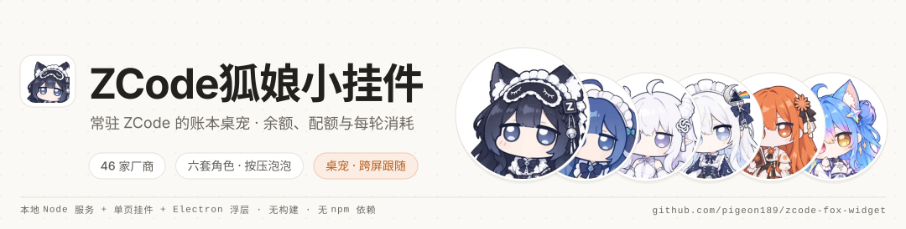
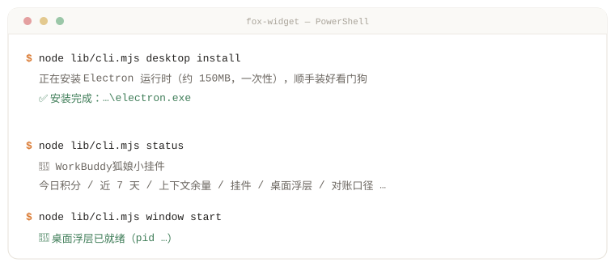
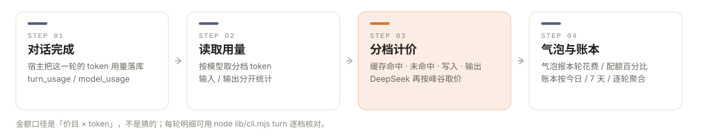
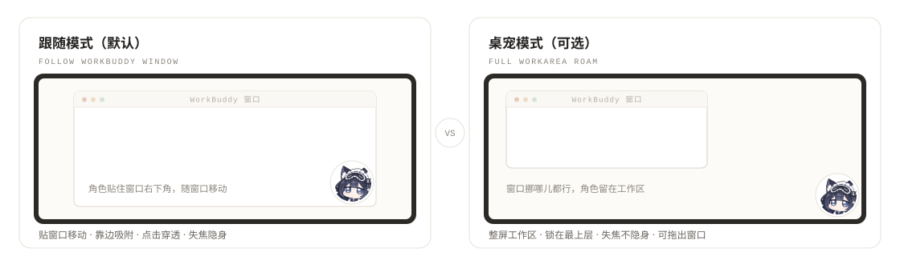
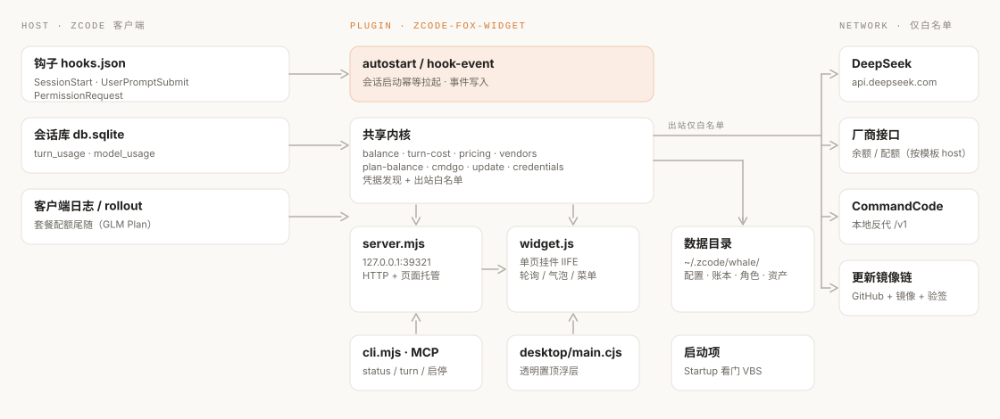

<div align="center">
  
  <br/>
</div>

<p align="center">
  <a href="https://github.com/pigeon189/zcode-fox-widget/releases"></a>
  
  
  <a href="./LICENSE"></a>
  <a href="https://github.com/pigeon189/zcode-fox-widget/stargazers"></a>
</p>

> 显示 **DeepSeek 余额**、**GLM Plan 剩余配额**、**GLM 按量现金余额**、**CommandCode 三重额度**、**各厂商今日已用**与**当前峰谷时段**；每轮对话结束弹一颗气泡，报告本轮花费。
>
> 浮层跟着 ZCode 窗口移动、最小化、关闭，指针不在它身上时点击直接穿透；开「桌宠模式」后以整个工作区为家，切应用也不隐身。ZCode 移到另一块显示器时，浮层会在窗口停稳约 0.7 秒后跟到那块屏（桌宠模式仍以启动时所在屏为家）。
>
> 同仓双分支：本分支 `main` 是 ZCode 线（按量余额口径）；另一条线是 <a href="https://github.com/pigeon189/zcode-fox-widget/tree/workbuddy"></a> WorkBuddy狐娘小挂件（订阅积分口径）。两条线的版本号与更新通道各自独立、互不包含。

## 30 秒了解

<table>
<tr>
<td width="33%" valign="top">
  <b>💰 余额与配额</b><br/>
  <sub>DeepSeek 余额、本机库口径的今日已用与峰谷时段；GLM Plan 双源配额、GLM 按量现金余额（接口不可用时退回今日已用）、CommandCode 三重额度、火山方舟订阅窗口。</sub>
</td>
<td width="33%" valign="top">
  <b>🏪 46 个厂商模板</b><br/>
  <sub>含 Kimi / MiniMax / Gemini 订阅与 10 家中转站；没有接口的厂商只报凭据状态，缺的数字显示为「未配置」或具体原因文案，绝不补 0。</sub>
</td>
<td width="33%" valign="top">
  <b>🧾 每轮消耗与账本</b><br/>
  <sub>按缓存命中 / 未命中 / 写入 / 输出分档计价，DeepSeek 再按峰谷取价；用量记录与记账二级页（预警、预算、校准）。</sub>
</td>
</tr>
<tr>
<td width="33%" valign="top">
  <b>🎭 六套角色与音效</b><br/>
  <sub>嘎啦嘛 / 大肥鱼 / GPT娘 / kimi娘 / 小克 / 哈基米；按模型自动换角色、气泡配色自定义，三套内置音效可导入。</sub>
</td>
<td width="33%" valign="top">
  <b>🐾 浮层与桌宠</b><br/>
  <sub>跟随窗口、贴边镜像、桌宠模式整屏漫游、跨屏 0.7 秒跟随、点击穿透；窗口不压自动隐藏任务栏的热区。</sub>
</td>
<td width="33%" valign="top">
  <b>🔄 自启、更新与迁移</b><br/>
  <sub>SessionStart 幂等拉起 + 登录看门进程；镜像链更新、落盘前验签；fox-dock 2.0 提供「查看说明后升级」两步迁移。</sub>
</td>
</tr>
</table>

## 快速开始

装插件 → 重启会话 → （要浮层再）装运行时 → 打开 ZCode。

**前置条件**

| 项目 | 要求 |
|---|---|
| ZCode 客户端 | 插件宿主，通过市场源安装 |
| Node.js | `node -v` 可用；`node:sqlite` 需 ≥ 22.5，缺了「每轮消耗 / 用量记录」会退化 |
| 操作系统 | 桌面浮层仅 Windows（依赖 Win32 与 PowerShell）；macOS / Linux 用本地页面：`node lib/cli.mjs start` 后浏览器打开 `http://127.0.0.1:39321/` |
| Electron 运行时 | 仅浮层需要，一次性安装（约 150MB 下载） |

### 安装

1. **加市场源（二选一）**

   **A. GitHub 源（推荐）**：设置 → 插件管理 → **发现** → 右上角 `+` → 市场源填
   `pigeon189/zcode-fox-widget`。宿主认 `owner/repo`，拉的就是默认分支 `main`；升级 = 对市场点「重新抓取」。

   **B. 本地目录（要改代码时用）**：克隆后在同一入口点 `+`，把**仓库绝对路径**填进市场源（指向含 `marketplace.json` 的仓库根）。

   > 同时装 WorkBuddy 版时，两边各克隆一份——两个宿主盯同一个工作区，任一端重抓都会覆盖另一端。

2. **安装并启用** `zcode-fox-widget`（安装后在插件管理里确认已启用；MCP 服务默认开启）。
3. **重启会话**（或重开 ZCode），让 MCP 与 hooks 生效。
4. **要桌面浮层再装运行时**：

   ```bash
   node lib/cli.mjs desktop install
   ```

装好后打开 ZCode，角色会自己出现。

**不装 Electron 或非 Windows**：`node lib/cli.mjs start`，浏览器打开 `http://127.0.0.1:39321/`（端口被占时会顺延，`status` 会打印实际地址）。本地页面具备除浮层专属项（桌宠模式、跟随延迟）之外的全部功能与面板，只是不能浮在 ZCode 窗口上。

> 以下命令都在**插件根目录**执行（市场安装时在 `.../plugins/cache/zcode-fox-local/zcode-fox-widget/<版本>/`）。

<p align="center">
  
</p>

日常就这三条命令：装运行时 → 看状态 → 起浮层（服务由会话钩子自动拉起，一般不用手动 `start`）。

更新与迁移的完整说明见 [功能详解 · 更新与迁移](#更新与迁移)。

## 首次配置

**API Key 只服务于 DeepSeek 余额卡；不配也能用**（余额卡显示「未找到 DeepSeek API Key」是正常状态）。

查找顺序（`lib/credentials.mjs`）：

1. 环境变量 `DEEPSEEK_API_KEY`
2. `~/.zcode/whale/config.json` 的 `apiKey`
3. ZCode 客户端里已配置的 DeepSeek provider（有效 baseURL 指向 `api.deepseek.com` 的接入点）——复用你已有的配置，零配置可用

<p align="center">
  
</p>

```bash
echo 'sk-xxxxxxxx' | node lib/cli.mjs key
```

`~/.zcode/whale/config.json` 常用字段：

| 字段 | 默认 | 作用 |
|---|---|---|
| `apiKey` | — | DeepSeek API Key（也可用 `key` 命令写入） |
| `platformToken` | — | 平台会话令牌（实时·令牌口径用，也可用环境变量 `DEEPSEEK_PLATFORM_TOKEN`） |
| `usageMode` | `ledger` | 对账口径的兜底初值；挂件初始化后的实际口径存在 `widget-state.json`，以菜单 / MCP 修改为准；`mode` 命令只写这里，菜单保存过设置后不再生效（菜单值优先） |
| `autoStartWidget` | `true` | 会话启动时拉起服务 |
| `autoStartOverlay` | `true` | 顺便拉起浮层（运行时未安装时静默跳过） |
| `autoStartWithZcode` | `true` | 登录后看门进程随 ZCode 启动拉起（不等 SessionStart） |
| `followIntervalMs` | `40` | 跟随探测间隔（写入时钳在 16–2000；菜单可选 16 / 40 / 100 / 250，选择存在本地并即时生效） |
| `refreshGlmWalletOnTurnComplete` | `false` | 回合结束时强制刷新一次 GLM 按量钱包余额（issue #18；只刷新这一个模板，失败保留旧值） |
| `minGlmWalletRefreshIntervalMs` | `120000` | 上一项两次刷新的最小间隔（毫秒）；下限固定 2 分钟、只能调大（读取时钳在 120000–3600000） |
| `port` | 自动（默认 39321） | 固定端口，占用时顺延 |

厂商凭据写在 `vendorKeys.<模板 id>`；中转站另有一类**账户级**查询（系统访问令牌 + 用户 ID），写在 `relayAuth.<站点 id> = { token, userId }`——只有 `vendorKeys` 时能查 token 额度，账户余额需要 `relayAuth`；挂件自身的外观与开关（大小、音效、音量、角色、主题、气泡、默认位置、桌宠模式、预警阈值等）在 `~/.zcode/whale/widget-state.json`（由挂件菜单写入）；跟随延迟在 `config.json` 的 `followIntervalMs`，菜单里的选择存在本地并在运行时生效；按压泡泡队列单独存 `~/.zcode/whale/bubble-content.json`。

### 火山方舟配额卡（可选）

菜单「显示」选 **火山方舟**（对应厂商模板 `volc-plan`），按当前火山接入自动区分按量估算与订阅套餐。凭据必须用火山 **IAM Access Key（`AKLT…`）** 做 V4 签名——模型调用用的 Coding Plan Key（`ark-…`）不适用：

1. 火山控制台 → 右上角头像 → 访问控制 → 新建用户（通过用户名创建，访问方式选**编程访问**）。
2. 授权勾选系统策略 `ArkReadOnlyAccess` + `BillingCenterReadOnlyAccess`（追求最小授权可只授自定义策略 `ark:GetCodingPlanUsage`），创建后生成 AK/SK。
3. 二选一配置（现读、不落盘日志）：环境变量 `VOLC_ACCESS_KEY_ID` / `VOLC_ACCESS_KEY_SECRET`（含多套别名），或 `config.json` 的 `{"vendorKeys":{"volc-access-key-id":"AKLT…","volc-access-key-secret":"…"}}`。AK/SK 是成对的两个键，不走其它厂商的单键模式；未配置时卡片会如实提示。

接口只给 5 小时 / 周 / 月三个窗口的已用百分比，没有调用次数也没有金额；未订阅 / 无数据如实显示，不补 0%。接入类型按官方 Base URL 路径自动识别：`/api/v3` = API 本地按量估算，`/api/coding` = Coding Plan，`/api/plan` = Agent Plan。判定规则、显示行为与边界（账号绑定、企业版、旧配置迁移等）见 [`docs/VOLC-URL-ROUTING.md`](https://github.com/pigeon189/zcode-fox-widget/blob/main/docs/VOLC-URL-ROUTING.md)；排查用 `node lib/cli.mjs providers` 或 `/whale/volc.json?providerId=<编码后的 ID>&refresh=1`。本机时间偏差超过 15 分钟会提示「本机时间偏差过大（校准后重试）」，校准时钟即可。

## 功能详解

### 每轮消耗与账本

<p align="center">
  
</p>

每轮对话结束后，宿主把这一轮的 token 用量落库；挂件按模型取分档 token，再按缓存命中 / 未命中 / 缓存写入 / 输出分档计价，DeepSeek 额外按峰谷取价。结果分成两路：气泡报本轮花费（或配额百分比），账本按今日 / 近 7 天 / 逐轮聚合，可搜索。金额口径是「价目 × token」，可用 `node lib/cli.mjs turn` 逐档核对；数学细节见 [数据与计价口径](#数据与计价口径)。

### 浮层与桌宠

<p align="center">
  
</p>

- 角色可拖到窗口内任意位置，靠边吸附，贴左缘时整体镜像。
- **指针要先落在角色上，点击才被浮层接管**——穿透设计的必然代价，换来不误触。
- 普通交互不抢 ZCode 前台；菜单里的输入控件按上去才临时接管键盘，离开即交还。
- 浮层窗口四边各内缩 4 DIP 安全边距，不压制自动隐藏任务栏的滑出热区（issue #8）。
- **桌宠模式**（菜单可开关）：角色以整个工作区为家，可以拖出 ZCode 窗口；锁在最上层、失焦也不隐身，适合把角色放在桌面角落常驻。唯一例外是全屏应用（游戏 / 全屏视频）在前台时会自动让路，退出全屏后恢复。

### 角色与音效

<table align="center">
<tr>
<td align="center"><br/><sub><b>嘎啦嘛</b><br/>glm / zhipu / chatglm / z.ai / zai- / bigmodel</sub></td>
<td align="center"><br/><sub><b>大肥鱼</b><br/>deepseek</sub></td>
<td align="center"><br/><sub><b>GPT娘</b><br/>gpt / openai / chatgpt / o1- / o3- / o4- / codex</sub></td>
</tr>
<tr>
<td align="center"><br/><sub><b>kimi娘</b><br/>kimi / moonshot</sub></td>
<td align="center"><br/><sub><b>小克</b><br/>claude / anthropic</sub></td>
<td align="center"><br/><sub><b>哈基米</b><br/>gemini</sub></td>
</tr>
</table>

「按模型换角色」按模型标识的**小写子串**匹配上表关键词（ZCode 的模型标识形如 `deepseek/deepseek-flash`，既有网关前缀也有套餐前缀，只有子串匹配能罩住）；认不出的模型不动当前角色，手选形象后自动关闭换角。每套角色有专属台词池；角色可导入、改名、删除，内置形象也能隐藏；每个角色还能单独改浅色 / 深色两档气泡配色（内嵌调色板 + HEX/RGB 输入）。

**音效**：内置三套——小黄鸭（`duck`）、嘀嘟（`fx1`，v1.16.3 前显示为「音效1」，已保存的选择不受影响）、猫娘（`nya`，按压喵声、松手静音；素材 CC0，出处见 [`NOTICE`](./NOTICE) 与 [`docs/CATGIRL-SOUND-NOTES.md`](./docs/CATGIRL-SOUND-NOTES.md)）；支持导入自定义音效集，音量可调、0 即静音。

### 自启与看门进程

插件带三个低频钩子：**SessionStart** 幂等拉起服务（顺带拉起已装运行时的浮层）、**UserPromptSubmit** 与 **PermissionRequest** 把「开始干活 / 在等你确认」写给挂件（思考气泡与等确认提醒的数据源）。同时默认在 Windows 启动文件夹放一个隐藏的看门进程，每 3 秒探测一次 `ZCode.exe`，一出现就做一次幂等启动——不用先选会话。不碰注册表、不需要管理员、不存密钥；日志在 `~/.zcode/whale/autostart.log` 与 `~/.zcode/whale/zcode-watch.log`。（workbuddy 分支同一能力叫「看门狗」，命令为 `node lib/cli.mjs watchdog install|status|uninstall`。）

```bash
node lib/cli.mjs watch status      # 看门进程与 Startup 项状态
node lib/cli.mjs watch install     # 立即安装并启动（SessionStart 也会自动确保）
node lib/cli.mjs watch uninstall   # 卸载 Startup 项并停掉看门进程
node lib/cli.mjs watch stop        # 只停看门进程、保留 Startup 项
node lib/cli.mjs watch once        # 只探测一次并拉起（排障）
```

不想要看门进程就 `watch uninstall`；把 `autoStartWithZcode` 设为 `false` 后，下次会话启动也会自动卸载。

### 在对话里用

输入 `/fox`（或 `/fox turn`、`/fox window start`），或直接问「我还有多少余额」——ZCode 会调 MCP：

| 工具 | 作用 |
|---|---|
| `whale_balance` | 余额、今日已用、峰谷时段 |
| `whale_last_turn` | 上一轮消耗与明细 |
| `whale_widget` | 服务与浮层的启停 / 状态 |
| `whale_config` | 查看或修改配置（Key、口径、端口、会话自启；跟随延迟在菜单或 `config.json` 里改） |

### 更新与迁移

<p align="center">
  
</p>

- **市场刷新**：对对应市场源点「重新抓取」（路径 A 为 GitHub 源 `pigeon189/zcode-fox-widget`，路径 B 为本地目录市场 `zcode-fox-local`）→ 重装 → 重启客户端（宿主按版本号建新目录，最干净）。
- **挂件内更新**：菜单「检查更新…」→ 有新版时「立即更新」→ 完成后「重启挂件」。走镜像候选链，落盘前校验发布签名清单；也可以关掉后台自动检查与迁移探测（`WHALE_DISABLE_UPDATE_CHECK=1`；手动点「检查更新」仍会出站一次。workbuddy 分支同一链路默认关，开启开关是 `FOX_WIDGET_ENABLE_UPDATE_CHECK=1`）。
- **迁到 fox-dock 2.0（独立桌宠程序）**：fox-dock 2.0 正式版发布后，「检查更新…」面板会出现迁移入口——先点「查看说明后升级」在系统浏览器里看功能与升级代价，确认后按钮变「立即升级」，点击只做本机只读预检并给出安装引导（不代下载、不停服务、不动现有数据）。跳过迁移不影响普通更新；`node lib/cli.mjs migrate --check` 可随时只读预检；`FOX_WIDGET_DISABLE_MIGRATION=1` 阻止后续迁移探测（已探测到并落盘的入口不会立即消失；要先取消该变量、等下一次探测，或清掉 `update-state.json` 的 `migrationProbe`）。
- 远端清单宣告停止维护（eol）时，点「立即更新」会得到「1.x 更新已停止维护」的提示（下载前只读拦截）；若出现「更新被 eol 拦截」的误报，先看数据目录 `update-state.json` 的 `migrationProbe.eol`，远端清单撤掉 eol 后下一次探测会自动解除；急用可把该字段改为 `false`，改完刷新更新面板即可（无需重启）。不建议删整个 `update-state.json`——下一次探测可能把 eol 重新写回。迁移面板的「跳过此版本」只做跳过，不提供撤销入口。

数据（key、账本、角色、泡泡、Electron 运行时）都在 `~/.zcode/whale/`，两种更新方式都不丢配置。完整性与发布流程见 [`CONTRIBUTING.md`](./CONTRIBUTING.md) 的「发布物完整性」。

## 数据与计价口径

- **今日已用 = 本机库（主口径）**：读 ZCode 落库的每轮用量，按各厂商价目折算；按模型可见、不受充值干扰。
- **预付池不计真金白银**：GLM Plan 与 CommandCode credit 的钱在买额度时就付了，只按配额 / tokens 报，不并进「今日已用」。
- **GLM 按量账户显示现金余额**：气泡主数字读账户报表接口的 `availableBalance`（人民币），小字显示今日已用；接口不可用时自动退回「今日已用」口径。有 GLM Plan 套餐的账户仍显示 Plan 百分比，不显示现金余额。刚充值或刚跑完大消耗时，可开 `refreshGlmWalletOnTurnComplete` 让每轮结束强制刷新一次钱包余额（默认关；最小间隔 2 分钟、只能调大；失败保留旧值，不弹气泡、不影响回合流程）。
- **对账口径兜底**：记账（观测余额下降）覆盖该账号全部花费但会漏记停机期间；实时·令牌需要 `DEEPSEEK_PLATFORM_TOKEN`，过期自动回落。两口径不一致时并排展示。
- **每轮消耗**：按缓存命中 / 未命中 / 缓存写入 / 输出分档计价，DeepSeek 再按峰谷取价（MiMo Token Plan 另有夜间 0–8 点 0.8x 系数）；输入 token **含缓存**，折价前必须减掉（否则虚高十几倍）。
- **等价金额（`≈`）不代表真实扣费**，只用于横向比较。

`node lib/cli.mjs turn` 可逐档核对；价目在 `lib/pricing.mjs` 顶部，复核流程见 [`skills/fox-pricing-review/SKILL.md`](./skills/fox-pricing-review/SKILL.md)。

## 架构

<p align="center">
  
</p>

| 组件 | 文件 | 职责 |
|---|---|---|
| 挂件服务 | `lib/server.mjs` | 本地 HTTP 服务（默认 `127.0.0.1:39321`），提供页面、图片、音效、全部 JSON 接口 |
| 前端挂件 | `lib/widget.js` | 原生 JS，拖拽 / 吸附 / 翻转 / 气泡 / 菜单 / 音效 / 数字滚动，以及浮层穿透切换 |
| 桌面浮层 | `desktop/main.cjs`、`desktop/preload.cjs` | 透明置顶无边框窗口承载挂件页面，默认鼠标穿透，只加载本机 127.0.0.1 |
| 浮层管理 | `lib/overlay.mjs` | 浮层单例检查、启停，以及 Electron 运行时的按需安装 |
| 余额与账本 | `lib/balance.mjs` | 拉余额、记账模式累计、平台用量换算、25 秒缓存与瞬时失败回退 |
| 厂商配额 | `lib/vendors.mjs`、`lib/volc-plan.mjs` | 厂商余额 / 配额模板框架；火山方舟 Coding / Agent Plan 订阅窗口（V4 签名，45s TTL + in-flight 单飞） |
| 定价 | `lib/pricing.mjs` | 峰谷时段判定与 token→金额换算（改价目只改这里） |
| 每轮消耗 | `lib/turn-cost.mjs` | 读 ZCode 的 `turn_usage` 表，换算每轮金额 |
| 凭据与出站校验 | `lib/credentials.mjs` | 找 API Key、出站主机白名单校验 |
| MCP 工具 | `lib/mcp-server.mjs` | 会话内查询余额 / 启停挂件与浮层 / 改配置 |
| 命令行 | `lib/cli.mjs` | `status` / `turn` / `start` / `stop` / `restart-all` / `close` / `window` / `desktop install` / `key` / `mode` / `watch` / `migrate --check` / `providers` / `vendors` / `url` / `json` |
| 会话自启 | `lib/autostart.mjs`、`lib/watch-install.mjs`、`lib/zcode-watch.mjs` | SessionStart 幂等拉起；登录自启的看门进程（每 3 秒探测 `ZCode.exe`） |
| 挂件服务管理 | `lib/service.mjs` | 服务发现 / 拉起 / 关闭，跨进程启动锁与端口顺延 |
| 更新与迁移 | `lib/update.mjs`、`lib/migrate.mjs` | 镜像链探测、整包验签、失败回滚；fox-dock 2.0 迁移探测与只读预检 |
| 厂商发现与来源 | `lib/source.mjs`、`lib/discover.mjs` | 计费源判定；从宿主配置发现凭据 |
| 中转站与用量记录 | `lib/relays.mjs`、`lib/usage-records.mjs` | 10 家中转站的额度查询；用量记录面板的数据聚合 |
| 跟随脚本 | `desktop/follow-window.ps1`、`desktop/window-bounds.cjs`、`desktop/display-follow.cjs` | Win32 窗口位置探测、工作区边界与跨屏切换判定 |

**46 个厂商模板的构成**（`lib/vendors.mjs` 的 `TEMPLATES`）：

| 类型 | 数量 | 说明 |
|---|---|---|
| 余额接口（`kind: balance`） | 7 | DeepSeek、GLM 按量（现金余额）、OpenRouter、Kimi 国内 / 国际、StepFun、Novita |
| 订阅窗口（`kind: quota`） | 6 | 智谱 Coding Plan（国内 / 国际）、Kimi Coding、MiniMax Coding（国内 / 国际）、OpenCode Go |
| 套餐 / 本地（`local-log` / `cmdgo` / `volc`） | 3 | GLM Plan、CommandCode、火山方舟 |
| 按量计价（`kind: tokens`） | 20 | OpenAI、Claude、Gemini、Qwen、Grok、Mistral 等；官方无余额接口，只报凭据状态，金额走本机 token 用量 |
| 中转站（`kind: relay`） | 10 | 见 [`lib/relays.mjs`](./lib/relays.mjs) |
| **合计** | **46** | |

## 命令行

```bash
node lib/cli.mjs status           # 余额 + 今日已用 + 服务与浮层状态
node lib/cli.mjs turn             # 上一轮消耗与逐档明细
node lib/cli.mjs start / stop     # 启停挂件服务（页面与浮层共用）
node lib/cli.mjs window start|stop|status|restart
node lib/cli.mjs desktop install  # 安装 Electron 运行时（仅浮层需要）
node lib/cli.mjs restart-all      # 服务 + 浮层一起重启
node lib/cli.mjs close            # 本次关闭（不写自启开关）
echo 'sk-...' | node lib/cli.mjs key   # 写 Key（走 stdin，不留命令行痕迹）
node lib/cli.mjs mode ledger|token     # 写兜底口径（菜单未保存过时生效）
node lib/cli.mjs watch status|install|uninstall|stop|once   # 看门进程（见上）
node lib/cli.mjs migrate --check  # fox-dock 2.0 迁移只读预检（输出 JSON）
node lib/cli.mjs providers        # 查看厂商接入 ID 与来源（不输出密钥）
node lib/cli.mjs vendors          # 全部厂商余额 / 配额与不可用原因（不输出密钥）
node lib/cli.mjs url              # 打印当前挂件地址
node lib/cli.mjs json             # 结构化输出
```

## 数据目录与故障排查

数据都在 `~/.zcode/whale/`：

| 文件 / 目录 | 内容 |
|---|---|
| `config.json` | 配置（Key、口径、端口、自启、跟随间隔、厂商凭据 `vendorKeys` / 中转站 `relayAuth`） |
| `widget-state.json` | 外观与开关（大小、音效、角色、主题、气泡、默认位置、桌宠模式、预警阈值） |
| `usage-ledger.json` | 记账账本（按 key 分本；换 key 不混算） |
| `roles.json` + `roles/`、`sounds.json` + `sounds/`、`bubble-content.json`、`bubble-templates.json` | 自定义角色、音效集、按压泡泡队列与模板 |
| `update/` | 更新下载与备份工作区（可删） |
| `server.json` | 本地服务的随机令牌（停止服务要用） |
| `update-state.json` | 更新状态与迁移预检记录（`migrationProbe`） |
| `autostart.log` / `zcode-watch.log` | 自启与看门进程日志 |
| `overlay-debug.log` | 浮层调试日志 |
| `zcode-theme-observed.json` | 「跟随 ZCode」的主题观测（浮层跟随脚本写，自动保鲜） |
| `desktop-runtime/` | Electron 运行时（仅浮层用，可重装） |

**排障入口**：先跑 `node lib/cli.mjs status` 看双口径与来源；反馈问题时菜单 →「关于 / 自检…」→「全选复制」，把那段脱敏 JSON 一起发出来（不含密钥，路径已脱敏）；服务健康看 `/whale/health`。以下常见现象先对号入座：

<details>
<summary>常见现象对照表（点开）</summary>

| 现象 | 处理 |
|---|---|
| 界面上看不到挂件 | Windows 想浮在 ZCode 上需要浮层：`desktop install` 后 `window start`；其它情况用本地页面：`node lib/cli.mjs start`，浏览器打开 `http://127.0.0.1:39321/` |
| 打开 ZCode 没自动出现 | 看 `~/.zcode/whale/autostart.log` 最后一行：无新行 = hook 没加载；`skip: autoStartWidget=false` = 配置关了自启；`overlay=skipped:no-runtime` = 运行时没装 |
| 打开 ZCode 停在首页、挂件要等选会话才出现 | 看门进程没在跑：`node lib/cli.mjs watch status`；`watch install` 后重开 ZCode，日志在 `~/.zcode/whale/zcode-watch.log` |
| 点桌面 / 任务栏后挂件消失 | 普通模式在 ZCode 失焦时按设计隐身；菜单开「桌宠模式」后会一直悬浮（实测可压在浏览器 / 桌面上）。开了桌宠模式仍消失，再发版本号与 `overlay-debug.log` |
| 和挂件互动后 ZCode 画面卡住 | 确认浮层是新版（`window status` / `/whale/health` 的 version）。浮层的 `focusable:false` 与 `type:'toolbar'` 都不能删，否则会抢宿主前台或触发停帧 |
| 余额显示「未找到 DeepSeek API Key」 | 预期：三条来源都没命中。逐条看 `/whale/health` 的 `keyProbe` |
| 今日已用一直是 0 | 本机库今天还没记录；`cli.mjs status` 看双口径与来源 |
| 每轮消耗不弹 | 需要至少完成一轮对话（`turn_usage` 有 `completed`），且菜单里开关是开的 |
| 角色不跟着 ZCode 走 | `window stop` → `window start` 重建；浮层日志默认就写在 `overlay-debug.log`（`WHALE_OVERLAY_LOG=0` 关闭）；`WHALE_DEBUG_PORT=9333` 可接 DevTools 看 DOM / 输入 |
| 浮层里点不动 | 指针要先落在角色上（光标变 `grab`）；整块都点不动时检查是否有别的置顶窗口压着 |
| 菜单数字框打不了字 | 指针按上去就会临时接管键盘；仍不行说明浮层是旧版 |
| Plan 配额不显示 | 日志与接口都没数据；`/whale/plan.json` 的 `apiReason` / `probedDirs` 说明原因 |
| CommandCode 读不到 | 两条来源：宿主里配置的 CommandCode 官方 provider，或本机反代的 `~/.cmdgo-bridge/credentials.json`。先确认 provider 的 key 有效，再看反代是否在跑；`node lib/cli.mjs vendors` 会给出具体 `reason` |
| 换了图片 / 音效不生效 | 资产路由 `no-store`，强刷即可；确认替换的是 `assets/` 下的同名文件 |

</details>

### 已知限制

- 浮层仅 **Windows**（依赖 Win32 与 PowerShell）；非 Windows 用本地页面（见「快速开始」）。
- 跟随靠轮询，拖动时理论上有约一个探测间隔的滞后（默认 40ms，实测约 13ms）。
- 浮层内吸附无滑动动画（避免透明窗口合成层错位）；本地页面里动画完整。
- 每轮消耗只统计 ZCode 记录的轮次，宿主外直接调用的 API 不计入。

## 卸载

按「先停进程 → 再移除自启 → 最后删数据」的顺序：

1. **停掉挂件**：`node lib/cli.mjs close`（等价于 `window stop` + `stop`）。
2. **移除登录自启**：`node lib/cli.mjs watch uninstall`。它会删除 Startup 文件夹里的看门 VBS 并停掉看门进程；插件已卸载、CLI 不可用时，手动删 Startup 里的 `zcode-fox-widget-watch.vbs` 即可（WorkBuddy 线的文件名是 `fox-widget-watchdog.vbs`，别删错）。
3. **卸载插件**：在 ZCode 插件管理里卸载或停用 `zcode-fox-widget`。
4. **删除数据目录**（可选）：`~/.zcode/whale/`。里面有 Key、账本、角色、音效、配置、更新备份与 Electron 运行时（`desktop-runtime/`）；**删除后不可恢复**，需要保留就先备份。运行时只服务于浮层，删掉后本地页面仍可用，下次用浮层需重新 `node lib/cli.mjs desktop install`。

插件不写宿主配置；除了插件缓存与这个 Startup 项，没有别的系统级残留。`~/.zcode/whale/` 之外的 ZCode 数据（会话库、日志）不会被本插件删除。

## 安全

- **出站白名单**：DeepSeek 余额 / 对账链路只发往 `api.deepseek.com` / `platform.deepseek.com`；厂商余额与配额卡按模板各自发往对应官方域名，每条请求仍过出站白名单校验（拒绝环回 / 私有 / 保留地址）；更新链路是另一份白名单（GitHub 与转发镜像）。
- **本地服务**：只监听 `127.0.0.1`，校验 `Host` 与写操作 `Origin`；停止服务要 `server.json` 里的随机令牌。
- **更新**：下载整包在内存中解压、逐条校验路径，并核对发布签名清单（`.release-hashes.json` + ed25519）；清单外文件忽略不落盘。
- **浮层**：只加载本机页面，`contextIsolation` 下仅暴露必要 IPC；外链交给系统浏览器。
- **凭据**：来自环境变量或 0600 权限的 `config.json`（`apiKey` / `platformToken` / `vendorKeys` / `relayAuth`），请求时现读；不写日志、界面只显示掩码，不复制到其它文件。
- **看门进程**：只用当前用户 Startup 文件夹里的一个隐藏 VBS，不碰注册表、不需要管理员、不存密钥；它只探测 `ZCode.exe` 并调用一次幂等启动，`node lib/cli.mjs watch uninstall` 可随时移除。

## 文档索引

| 想找 | 去哪 |
|---|---|
| 安装 / 使用 / 排障 | 本文件 |
| 这版改了什么 | [CHANGELOG.md](./CHANGELOG.md) |
| 发布流程与发布物完整性、文档风格 | [CONTRIBUTING.md](./CONTRIBUTING.md) |
| 给 ZCode 内助手读的使用说明 | [skills/zcode-fox-widget/SKILL.md](https://github.com/pigeon189/zcode-fox-widget/blob/main/skills/zcode-fox-widget/SKILL.md) |
| 价目人工复核流程 | [skills/fox-pricing-review/SKILL.md](./skills/fox-pricing-review/SKILL.md) |
| 火山方舟接入判定与边界 | [docs/VOLC-URL-ROUTING.md](https://github.com/pigeon189/zcode-fox-widget/blob/main/docs/VOLC-URL-ROUTING.md) |
| 猫娘音效出处与加工记录 | [docs/CATGIRL-SOUND-NOTES.md](./docs/CATGIRL-SOUND-NOTES.md) |
| 一次性调查 / 交接档案 | [docs/INDEX.md](./docs/INDEX.md) |
| 素材出处与授权 | [NOTICE](./NOTICE) |

## 鸣谢与许可证

| 来源 | 说明 |
|---|---|
| 原版 | [MeteorNOX/DeepSeek-Balance-Whale-Widget](https://github.com/MeteorNOX/DeepSeek-Balance-Whale-Widget)（MIT）——DSH 的 Web 插件 |
| ZCode 移植 | nb10yyds / zcode-whale-widget（原仓库当前不可访问，GitHub 返回 404；沿革见 [`NOTICE`](./NOTICE)）——宿主适配层重写 |
| 本仓库 | fork 自该移植版（v1.1.0 起延续开发，v1.8.5 起用现名） |

视觉、鲸鱼素材、音效、台词与定价表来自上游；`GLM.png` / `gpt.png` / `kimi.png` / `gemini.png` 为本项目自有素材，`xiaoke.png` 取自 [aklnaaw/dsh-xiaoke-widget](https://github.com/aklnaaw/dsh-xiaoke-widget)（MIT，已获授权）；猫娘音效来自 Cici Fyre 的 *Free Catgirl Fighting Voice Pack*（CC0 1.0 Universal）。逐条清单见 [`NOTICE`](./NOTICE)。

**贡献者**

| 贡献者 | 说明 |
|---|---|
| [@pigeon189](https://github.com/pigeon189)（pigeon） | 维护者；移植、计价内核、浮层与绝大多数提交 |
| [@nb10yyds](https://github.com/nb10yyds) | 本仓库初始提交与上游移植基线 |
| [@FoobarRogers](https://github.com/FoobarRogers) | 火山方舟配额卡与 URL 路由、猫娘音效集 |
| [@Edritc](https://github.com/Edritc) | 浮层跨屏跟随、更新面板与上屏修复 |

感谢 [@Edritc](https://github.com/Edritc) 反馈浮层冷启动不上屏（issue #4），以及 B 站用户 @不将就的情初 提出「ZCode 启动即自启」的建议；也感谢所有提交 issue 与反馈问题的用户。

**许可证**

[MIT](./LICENSE)。

```text
MIT License · 上游 © 2026 MeteorNOX，本仓库 © 2026 pigeon189
```
